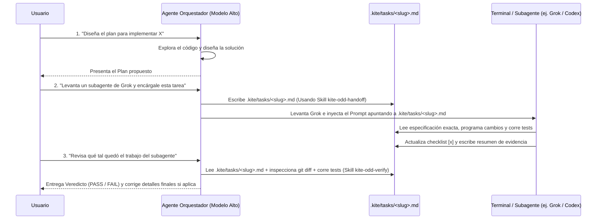

# Plan de Implementación 1: Orquestación ODD (Planner $\rightarrow$ Executor) y Sistema de Skills en Kite Code

> [!IMPORTANT]
> **Propósito de este documento:** Este plan está redactado con nivel de especificación ejecutable (*Agent-Ready Spec*). Cualquier agente desarrollador puede tomar cada fase de este documento e implementarla directamente en `E:\kite` siguiendo las rutas de archivos, estructuras de datos y tests aquí definidos.

---

## 1. Hallazgos Clave de `Gentleman-Programming/gentle-shell` (Por qué ODD supera a SDD)

Al auditar el repositorio oficial de **[`Gentleman-Programming/gentle-shell`](https://github.com/Gentleman-Programming/gentle-shell)** (v4.1 / `gentle-pi`), identificamos por qué evolucionaron desde el SDD clásico de 10 fases hacia **ODD (Organic-Driven Development)** y qué debemos adoptar en **Kite Code**:

### Lo que Sí sirve (y adoptaremos en Kite Code):
1. **"Keep Small Work Small" + Un Único Documento de Feature (`odd/tasks/<feature>.md`):**
   - En lugar de obligar a crear 5 archivos separados (`proposal.md`, `spec.md`, `design.md`, `tasks.md`, `verify.md`), ODD utiliza **un único documento vivo por tarea grande** (en Kite: `.kite/tasks/<slug>.md`).
   - Ese único documento contiene: **Objetivo**, **Especificación exacta (verbatim)**, **Archivos permitidos**, **Checklist de tareas con IDs (`T1`, `T2`)**, **Comando de tests** y **Evidencia de cierre**.
2. **Descubrimiento Crítico de Benchmark (PR #1718 de `gentle-shell` — *"Pass Spec by Reference, Never Paraphrase"*):**
   - En los benchmarks de `gentle-shell`, cuando el Agente Orquestador **resumía o parafraseaba** el plan al pasárselo al subagente, el subagente fallaba 13 de 26 pruebas ocultas porque perdía nombres exactos de variables, casos borde y restricciones.
   - Cuando el Orquestador guarda el plan completo en el archivo de tarea (`.kite/tasks/<slug>.md`) y le inyecta al subagente la orden de leer ese archivo literal como su fuente de verdad, **el subagente aprueba en la primera ronda**.
3. **Enrutamiento por Perfiles de Modelo (*Profiles & Model Routing*):**
   - El **Agente Orquestador (Padre)** usa un modelo de alto razonamiento (ej. Antigravity con Gemini Pro High, Claude Opus, o3) y mantiene la responsabilidad de la sesión.
   - Los **Subagentes Ejecutores (Workers)** usan motores rápidos/económicos o especializados (`grok`, `codex`, `claude`, `agy`) con contexto limpio para implementar la tarea asignada.
4. **Revisión Proporcional Basada en Evidencia (*Native Review / Bounded Check*):**
   - No se revisan checkboxes vacíos: cuando tú pides revisar el trabajo del subagente, se evalúa el `git diff` real más la ejecución real de los tests (`cargo test`, `npm test`), acotando las correcciones para no caer en bucles infinitos.

### Lo que Descartamos de `gentle-shell`:
- **Git Worktrees por subagente:** `gentle-shell` heredó vistas de worktrees para Pi, pero como definimos para Kite, todos los subagentes trabajarán sobre el **mismo workspace** para evitar duplicar `node_modules/` y `target/`.
- **Complejidad de permisos POSIX / Fingerprints criptográficos de RDD:** Innecesario cuando el usuario controla cuándo delegar y cuándo pedir la revisión.

---

## 2. Arquitectura del Flujo ODD en Kite Code



---

## 3. Especificación de Implementación por Tareas (Work Units)

### Unidad 1: Creación de las Skills ODD Estructuradas en `E:\kite\skills\`

Se crearán tres skills nativas en el repositorio para estandarizar el comportamiento del Orquestador y de cualquier Subagente:

#### Tarea 1.1: `E:\kite\skills\kite-odd-handoff\SKILL.md`
- **Rol:** Usada por el **Agente Orquestador** cuando el usuario le pide preparar un plan o delegar una tarea a un subagente.
- **Reglas obligatorias dentro de la Skill:**
  1. Crear el archivo `.kite/tasks/<task-slug>.md` (sin parafrasear ni omitir detalles técnicos) con la siguiente estructura exacta:
     ```markdown
     # ODD Task: <Title>
     - **ID:** <task-slug>
     - **Target Engine:** <grok | codex | claude-code | antigravity | open-code>
     - **Status:** ready

     ## 1. Objective & Verbatim Spec
     <Descripción exacta de qué debe hacer y escenarios WHEN / THEN>

     ## 2. Allowed Files & Boundaries
     - **Modify/Create:** `<lista de rutas exactas>`
     - **Read-Only Reference:** `<lista de rutas de contexto>`
     - **Out of Scope:** Do NOT touch files outside this list.

     ## 3. Implementation Checklist
     - [ ] **T1:** <Paso técnico detallado 1 con firmas/tipos exactos>
     - [ ] **T2:** <Paso técnico detallado 2>

     ## 4. Verification & Test Command
     - **Test Runner Command:** `<ej. npx vitest run src/... o cargo check>`
     - **Required Tests:** `<casos de prueba que deben existir y pasar>`

     ## 5. Subagent Execution Evidence (Filled by Executor)
     - **Modified Files:** (pending)
     - **Test Output Summary:** (pending)
     - **Notes:** (pending)
     ```
  2. Generar el comando o bloque de delegación inyectando al subagente la ruta `.kite/tasks/<task-slug>.md`.

#### Tarea 1.2: `E:\kite\skills\kite-subagent-executor\SKILL.md`
- **Rol:** Instrucciones que recibe el **Subagente Ejecutor** (Grok, Codex, Claude, etc.) al ser levantado.
- **Reglas obligatorias:**
  1. Leer primero `.kite/tasks/<task-slug>.md` completo antes de editar cualquier archivo.
  2. Respetar estrictamente la sección `Allowed Files & Boundaries`.
  3. Implementar en orden `T1`, `T2`, etc., sin re-planificar la arquitectura.
  4. Ejecutar el `Test Runner Command`. Si falla, corregir el código (máximo 3 intentos acotados).
  5. Marcar `[x]` en los ítems completados de `.kite/tasks/<task-slug>.md`, rellenar la sección `5. Subagent Execution Evidence` y terminar.

#### Tarea 1.3: `E:\kite\skills\kite-odd-verify\SKILL.md`
- **Rol:** Usada por el **Agente Orquestador** únicamente cuando el usuario pide: *"Revisa qué tal quedó"*, *"Verifica el trabajo del subagente"* o `/verify`.
- **Reglas obligatorias:**
  1. Leer `.kite/tasks/<task-slug>.md`.
  2. Ejecutar `git status --short` y `git diff` sobre los archivos modificados.
  3. Verificar que no se hayan modificado archivos prohibidos ni dejado código incompleto (`TODO`, `unimplemented!()`, mocks rotos).
  4. Ejecutar el `Test Runner Command` por cuenta propia para confirmar en tiempo de ejecución que compila y pasa los tests.
  5. Emitir un informe conciso con:
     - Tabla de cumplimiento (`T1: PASS/FAIL`, `T2: PASS/FAIL`, `Tests: PASS/FAIL`).
     - Veredicto final: `VERDICT: PASS`, `PASS WITH WARNINGS`, o `FAIL`.

---

### Unidad 2: Soporte en Backend Rust para Levantar Motores con Prompt Inicial (`src-tauri`)

Actualmente, [`build_agent_cli_args`](file:///E:/kite/src-tauri/src/terminal.rs#L435) en [`src-tauri/src/terminal.rs`](file:///E:/kite/src-tauri/src/terminal.rs) levanta los motores en modo `Fresh` o `Resume`, pero no les pasa un prompt inicial ni flags de auto-aprobación cuando se levanta un subagente en terminal.

#### Tarea 2.1: Extender `SpawnOptions` y `build_agent_cli_args` en [`src-tauri/src/terminal.rs`](file:///E:/kite/src-tauri/src/terminal.rs)
- **Archivo a modificar:** [`src-tauri/src/terminal.rs`](file:///E:/kite/src-tauri/src/terminal.rs)
- **Cambios exactos:**
  1. En `struct SpawnOptions` (línea 123), agregar:
     ```rust
     pub initial_prompt: Option<String>,
     pub auto_approve: bool,
     pub system_prompt: Option<String>,
     ```
  2. En `build_agent_cli_args` (línea 435), recibir `initial_prompt: Option<&str>`, `auto_approve: bool`, `system_prompt: Option<&str>` y mapear por motor cuando se provee un `initial_prompt`:
     - **`grok`**:
       - Si `auto_approve`: agregar `"--always-approve".to_string()`.
       - Si `system_prompt`: agregar `"--system-prompt-override".to_string(), sys.to_string()`.
       - Si `initial_prompt`: agregar `prompt.to_string()` como argumento posicional final (esto inicia la TUI de Grok ejecutando la tarea inmediatamente).
     - **`codex`**:
       - Si `auto_approve`: agregar `"--approve-for-me".to_string()`.
       - Si `initial_prompt`: agregar `prompt.to_string()` como argumento posicional final.
     - **`antigravity` (`agy`)**:
       - Si `auto_approve`: agregar `"--dangerously-skip-permissions".to_string()`.
       - Si `initial_prompt`: agregar `"-i".to_string(), prompt.to_string()` (`--prompt-interactive`).
     - **`claude-code` (`claude`)**:
       - Si `auto_approve`: agregar `"--permission-mode".to_string(), "bypassPermissions".to_string()`.
       - Si `initial_prompt`: agregar `prompt.to_string()` como argumento posicional final.
     - **`open-code` (`opencode`)**:
       - Si `auto_approve`: agregar `"--auto".to_string()`.
       - Si `initial_prompt`: agregar `"--prompt".to_string(), prompt.to_string()`.
  3. Actualizar el comando Tauri `spawn_terminal` en [`src-tauri/src/terminal.rs`](file:///E:/kite/src-tauri/src/terminal.rs) para leer `initialPrompt`, `autoApprove` y `systemPrompt` desde el payload JSON del frontend.

#### Tarea 2.2: Crear Módulo de Gestión de Tareas ODD y Subagentes (`src-tauri/src/odd_tasks.rs`)
- **Archivo a crear:** `src-tauri/src/odd_tasks.rs` (y registrarlo en [`src-tauri/src/main.rs`](file:///E:/kite/src-tauri/src/main.rs)).
- **Comandos Tauri a exponer:**
  1. `#[tauri::command] pub fn create_odd_task_file(request: Value) -> Result<Value, String>`:
     - Recibe `{ workspacePath, slug, title, targetEngine, objective, allowedFiles, checklist, testCommand }`.
     - Crea la carpeta `<workspacePath>/.kite/tasks/` si no existe.
     - Escribe `<workspacePath>/.kite/tasks/<slug>.md` con el formato estándar de la Unidad 1.
     - Construye el `subagentPrompt` listo para inyectar:
       ```text
       Lee el archivo `.kite/tasks/<slug>.md` y actúa como el Subagente Ejecutor. Implementa todos los puntos pendientes del checklist respetando los archivos permitidos, corre el comando de verificación indicado y actualiza la sección 5 del archivo con tu evidencia al terminar.
       ```
     - Devuelve `{ taskFilePath, relativePath, slug, subagentPrompt }`.
  2. `#[tauri::command] pub fn list_odd_task_files(request: Value) -> Result<Vec<Value>, String>`:
     - Escanea `<workspacePath>/.kite/tasks/*.md`, parsea el encabezado (`ID`, `Target Engine`, `Status`) y el conteo de checkboxes (`completed` / `total`), devolviendo la lista para que el frontend o el Orquestador sepan qué tareas existen.

---

### Unidad 3: Despacho de Subagentes desde la Interfaz de Chat (`src/`)

#### Tarea 3.1: Controlador de Despacho (`src/lib/subagentDispatcher.ts`)
- **Archivo a crear:** `src/lib/subagentDispatcher.ts`
- **Funciones a exportar:**
  1. `dispatchPlanToSubagentTerminal(options: { workspaceId: string; engine: string; planText: string; title?: string; autoApprove?: boolean }): Promise<{ sessionId: string; taskFilePath: string }>`:
     - Llama a `invokeCommand('create_odd_task_file', ...)` para guardar el plan en `.kite/tasks/<slug>.md` (cumpliendo la regla de *pasar la especificación por referencia*).
     - Emite un evento global `window.dispatchEvent(new CustomEvent('kite:spawn-agent-terminal', { detail: { engine, workspaceId, initialPrompt: subagentPrompt, autoApprove: true, title } }))` que abre el panel en [`TerminalView.tsx`](file:///E:/kite/src/components/views/TerminalView.tsx) y arranca el subagente con la tarea ya inyectada.
  2. `requestOrchestratorVerification(threadId: string, taskRelativePath: string)`:
     - Envía automáticamente un turno al chat del Orquestador con el prompt:
       `"Revisa qué tal quedó el trabajo del subagente en ${taskRelativePath} usando la skill kite-odd-verify: inspecciona el git diff, corre los tests correspondientes y dame el veredicto."`

#### Tarea 3.2: Botón "Delegar a Subagente" en Planes y Mensajes del Chat
- **Archivos a modificar:**
  - [`src/components/views/chat/ChatPlanPanel.tsx`](file:///E:/kite/src/components/views/chat/ChatPlanPanel.tsx)
  - [`src/components/views/chat/ChatItemRow.tsx`](file:///E:/kite/src/components/views/chat/ChatItemRow.tsx)
- **Cambios:**
  - Agregar un botón/selector compacto **"Delegar a Subagente ▾"** (con opciones: *Grok*, *Codex*, *Claude Code*, *Antigravity*, *OpenCode*).
  - Al seleccionar un motor (ej. *Grok*), llama a `dispatchPlanToSubagentTerminal(...)`, muestra una píldora en el chat indicando *"Delegado a Grok en `.kite/tasks/...` [Ver Terminal] [Revisar resultado]"*.
  - El botón **[Revisar resultado]** dispara `requestOrchestratorVerification(...)` con un solo clic cuando quieras que el Orquestador audite el trabajo terminado.

---

## 4. Plan de Pruebas y Verificación (Tests Obligatorios)

Para que cualquier agente ejecutor valide esta implementación, deberá crear y pasar los siguientes tests:

### 4.1. Tests en Rust (`cargo test` en `src-tauri`)
1. **`terminal::tests::test_build_agent_cli_args_with_initial_prompt_grok`**:
   - Verifica que `build_agent_cli_args("grok", ..., Some("Implement feature X"), true, None)` devuelva `["--always-approve", "Implement feature X"]`.
2. **`terminal::tests::test_build_agent_cli_args_with_initial_prompt_codex`**:
   - Verifica que para `"codex"` con `auto_approve = true` devuelva `["--approve-for-me", "Implement feature X"]`.
3. **`terminal::tests::test_build_agent_cli_args_with_initial_prompt_antigravity`**:
   - Verifica que para `"antigravity"` devuelva `["--dangerously-skip-permissions", "-i", "Implement feature X"]`.
4. **`odd_tasks::tests::test_create_and_list_odd_task_file`**:
   - Crea un archivo temporal `.kite/tasks/auth-refactor.md` usando `create_odd_task_file`, verifica que las 5 secciones existan en disco y que `list_odd_task_files` cuente correctamente los checkboxes `[ ]` y `[x]`.

### 4.2. Tests en Frontend (`npx vitest run`)
1. **`src/lib/subagentDispatcher.test.ts`**:
   - Verifica que `dispatchPlanToSubagentTerminal` invoque el comando IPC `create_odd_task_file` y dispare el evento `kite:spawn-agent-terminal` con el `subagentPrompt` apuntando al archivo `.kite/tasks/<slug>.md`.
   - Verifica que `requestOrchestratorVerification` construya el prompt de verificación invocando la skill `kite-odd-verify`.
