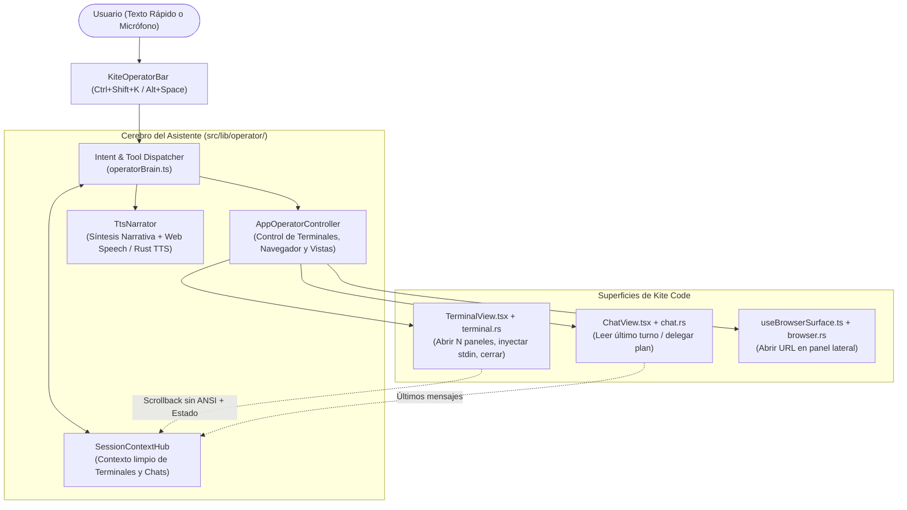

# Plan de Implementación 2: "Kite Operator" — Asistente de Acciones Rápidas, Contexto de Terminales y Voz (TTS)

> [!IMPORTANT]
> **Propósito de este documento:** Este plan define la arquitectura técnica exacta (archivos, interfaces TypeScript, comandos Rust y tests automatizados) para construir el **Asistente Operador de Kite Code**. Está diseñado para correlacionarse directamente con el **[Plan 1 (Orquestación ODD y Subagentes)](./plan-1-odd-orchestration-and-subagents.md)** y poder ser implementado paso a paso por agentes ejecutores.

---

## 1. Visión y Correlación con `gentle-shell` y el Plan 1

En **[`Gentleman-Programming/gentle-shell`](https://github.com/Gentleman-Programming/gentle-shell)** vimos dos ideas muy potentes para la gestión de sesiones:
1. **Cross-Session Activity Summary:** Cada sesión publica un estado ligero y reconocible (sujeto/título, motor, estado actual y resumen limpio de caracteres ANSI) que otras sesiones o el host pueden consultar al instante sin tener que leer megabytes de logs crudos.
2. **Command Palette / Quick Action Surface (`Alt+K`):** Una superficie rápida desde donde disparar acciones sobre el entorno con una sola pulsación.

En **Kite Code**, llevamos esto al siguiente nivel creando el **Kite Operator Assistant**: un asistente ultraligero (controlable por texto rápido o por voz) que actúa como **operador directo de la aplicación** y **narrador de contexto**:
- Puede **abrir $N$ terminales**, levantar agentes específicos en cada una (`grok`, `codex`, `claude`, `agy`) e **inyectarles prompts** de inmediato o en caliente.
- Puede **cerrar terminales** (por número, por motor o todas las que ya terminaron).
- Puede **abrir el navegador integrado** en cualquier URL o cambiar de vistas/workspaces.
- Está conectado al **Puente de Contexto (`SessionContextHub`)** de todas las terminales y chats activos, por lo que puedes pedirle: *"Léeme en voz alta el resumen de lo que hizo Grok en la terminal 2"* o *"¿Qué me respondió el orquestador?"* y te lo narrará con voz natural (**TTS**).

---

## 2. Arquitectura del Sistema



---

## 3. Especificación de Implementación por Unidades de Trabajo (Work Units)

### Unidad 1: Puente de Contexto de Terminales y Chats (`SessionContextHub`)

Para que el Asistente pueda responder preguntas sobre cualquier terminal o leer un resumen en voz alta, necesita acceder a un estado limpio y actualizado de cada sesión.

#### Tarea 1.1: Extender `src/lib/terminalRegistry.ts` para exponer el Buffer Limpio y la Tarea Asignada
- **Archivo a modificar:** `src/lib/terminalRegistry.ts`
- **Cambios exactos:**
  1. En la interfaz `ActiveAgentTerminal` (línea 8), añadir:
     ```ts
     index?: number;              // Número humano de terminal (1, 2, 3...)
     initialPrompt?: string | null; // Tarea inicial que se le inyectó
     lastInjectedPrompt?: string | null; // Último prompt enviado por stdin
     cleanScrollbackTail?: string; // Últimos 3500 caracteres limpios de ANSI y sin líneas de footer/chrome
     ```
  2. En `InternalSessionTracker` (línea 29), almacenar `initialPrompt` y `lastInjectedPrompt`.
  3. Exportar la función `getTerminalCleanContext(sessionId: string): { sessionId: string; engine: string; title: string; state: string; assignedTask: string | null; cleanTail: string } | null`:
     - Toma `rollingBuffer`, aplica `cleanAnsi()`, filtra las líneas donde `isChromeFooterLine(line) === true`, elimina líneas vacías consecutivas y devuelve los últimos `3500` caracteres limpios.
  4. Exportar la función `resolveTerminalByQuery(query: string): ActiveAgentTerminal | null`:
     - Permite encontrar una terminal cuando el usuario dice:
       - Un número o índice: `"1"`, `"terminal 2"`, `"segunda"` $\rightarrow$ devuelve la terminal en esa posición.
       - Un nombre de motor: `"grok"`, `"codex"`, `"claude"`, `"antigravity"` $\rightarrow$ devuelve la terminal activa con ese `engine`.
       - Un título o ID parcial.

#### Tarea 1.2: Crear el Agregador de Contexto (`src/lib/operator/sessionContextHub.ts`)
- **Archivo a crear:** `src/lib/operator/sessionContextHub.ts`
- **Interfaces y funciones a exportar:**
  ```ts
  export interface SessionContextDigest {
    id: string;
    kind: 'terminal' | 'chat';
    index: number;
    engine: string;
    title: string;
    state: 'working' | 'waitingForYou' | 'done' | 'idle' | 'exited';
    assignedTask: string | null;
    cleanLatestOutput: string;
    updatedAt: number;
  }

  export async function buildWorkspaceContextDigest(activeThreadId?: string | null): Promise<{
    terminals: SessionContextDigest[];
    activeChat: SessionContextDigest | null;
  }>;
  ```
- **Comportamiento:**
  - Reúne todas las terminales vivas desde `terminalRegistry.ts` con su `cleanScrollbackTail`.
  - Si hay un `activeThreadId`, consulta `load_chat_thread` (o el estado en memoria del chat) y extrae el último prompt del usuario (`assignedTask`) y la última respuesta del asistente (`cleanLatestOutput`, truncada a 3500 chars).

---

### Unidad 2: Controlador Programático de Terminales, Inyección y Navegador (`AppOperatorController`)

Esta unidad conecta con la **Unidad 2 del Plan 1** (`initial_prompt` en `terminal.rs`) y agrega control total en tiempo de ejecución sobre `TerminalView.tsx`.

#### Tarea 2.1: Crear `src/lib/operator/appOperatorController.ts`
- **Archivo a crear:** `src/lib/operator/appOperatorController.ts`
- **Funciones exactas (Herramientas del Asistente):**

  1. **`operatorSpawnTerminals(requests: Array<{ engine: string; prompt?: string; title?: string; autoApprove?: boolean }>, workspaceId?: string)`**:
     - Permite abrir $1..N$ terminales de golpe (ej. *"Abre 3 terminales: una con Grok haciendo X, una con Codex haciendo Y, y una normal"*).
     - Por cada elemento:
       - Si lleva `prompt` inicial, lo pasa en `initialPrompt` al spawnear el motor (usando el soporte nativo del Plan 1: `grok "prompt"`, `codex "prompt"`, `agy -i "prompt"`, `claude "prompt"`).
       - Además, registra un *fallback de inyección segura*: si el usuario pidió abrir una terminal genérica (`powershell`) o un motor que requiere inyección post-arranque, monitorea la salida hasta detectar que el proceso arrancó (o tras `800ms`) y escribe `prompt + "\r"` mediante `invokeCommand('write_terminal', { sessionId, data: prompt + '\r' })`.
     - Cambia automáticamente a la vista de Terminales si no estaba visible.

  2. **`operatorInjectPrompt(targetQuery: string, prompt: string)`**:
     - Busca la terminal objetivo usando `resolveTerminalByQuery(targetQuery)` (ej. `"terminal 1"`, `"grok"`, `"codex"`).
     - Registra `lastInjectedPrompt = prompt` en `terminalRegistry.ts`.
     - Llama a `invokeCommand('write_terminal', { sessionId: target.sessionId, data: prompt + '\r' })`.
     - Devuelve confirmación con el ID y título de la terminal donde se inyectó.

  3. **`operatorCloseTerminals(target: 'all' | 'done' | 'exited' | string)`**:
     - Si `target === 'done' || target === 'exited'`: cierra todas las terminales cuyo estado en `terminalRegistry` sea `done`, `idle` o `exited`.
     - Si `target === 'all'`: cierra todas las terminales del workspace actual.
     - Si es un query específico (ej. `"codex"` o `"terminal 2"`): resuelve la terminal con `resolveTerminalByQuery` y emite el evento de cierre + `invokeCommand('kill_terminal', { sessionId })`.

  4. **`operatorControlBrowser(action: 'open' | 'close' | 'reload', url?: string)`**:
     - Conecta con `useBrowserSurface.ts` / `browserSurfaceIpc.ts` para abrir el panel del navegador en la `url` indicada (normalizando puertos locales como `"localhost:3000"` $\rightarrow$ `"http://localhost:3000"`).

  5. **`operatorDelegateCurrentPlan(targetEngine: string)`**:
     - **Punto de unión directo con el Plan 1:** Toma el último plan del chat activo del Orquestador y llama a `dispatchPlanToSubagentTerminal({ engine: targetEngine, ... })` del Plan 1.

#### Tarea 2.2: Suscribir `src/components/views/TerminalView.tsx` a los Eventos del Operador
- **Archivo a modificar:** `src/components/views/TerminalView.tsx`
- **Cambios:**
  - Escuchar los eventos globales:
    - `kite:operator-spawn-terminals`: Crea los paneles en el grid de terminales (`panes`), invoca `spawn_terminal` con `initialPrompt` y ajusta el layout para mostrar las nuevas terminales.
    - `kite:operator-close-terminals`: Elimina los paneles indicados del estado de React y mata sus procesos PTY en backend.

---

### Unidad 3: Narrador de Resúmenes y Lectura en Voz Alta (`TtsNarrator`)

Cuando pides *"Léeme en voz alta el resumen de la terminal de Grok"* o *"¿Qué respondió el agente?"*, el sistema debe convertir la salida técnica en una explicación hablada limpia y reproducirla.

#### Tarea 3.1: Crear `src/lib/operator/ttsNarrator.ts`
- **Archivo a crear:** `src/lib/operator/ttsNarrator.ts`
- **Funciones exactas:**
  1. **`sanitizeTextForSpeech(rawText: string): string`**:
     - Limpia cualquier bloque de código triple (` ```...``` ` $\rightarrow$ los reemplaza por *"[bloque de código omitido]"* si no pasó por resumen LLM), elimina símbolos markdown (`#`, `*`, `` ` ``, tablas `|---|`), rutas de archivos largas (`E:\kite\src\components\...` $\rightarrow$ deja solo el nombre base `TerminalView.tsx`) y URLs crudas.
  2. **`generateSpokenSummary(digest: SessionContextDigest): Promise<string>`**:
     - Toma `digest.assignedTask`, `digest.state` y `digest.cleanLatestOutput`.
     - Construye un resumen conversacional breve (máximo 3–4 oraciones en el idioma del usuario) enfocado en:
       1. En qué estado está el agente (trabajando, esperando confirmación o terminado).
       2. Qué archivos o cambios principales realizó.
       3. Si hubo algún error o pregunta pendiente para el usuario.
  3. **`speakTextOutLoud(text: string, options?: { lang?: string; rate?: number; onEnd?: () => void })`** y **`stopSpeaking()`**:
     - Utiliza la API nativa de síntesis de voz del sistema (`window.speechSynthesis` que en Windows 11/WebView2 expone las voces neurales *Microsoft Natural* en español e inglés con latencia cero y sin costo de API).
     - Selecciona automáticamente la mejor voz disponible en español (`es-ES` / `es-MX` / `es-AR` *Natural*) o inglés según el texto.

---

### Unidad 4: Cerebro de Intenciones y Barra Flotante del Asistente (`KiteOperatorBar`)

#### Tarea 4.1: Clasificador Rápido + Ejecutor de Herramientas (`src/lib/operator/operatorBrain.ts`)
- **Archivo a crear:** `src/lib/operator/operatorBrain.ts`
- **Cómo funciona (Doble vía: Fast-Path Local Instantáneo + LLM Fallback):**
  1. **Fast-Path Determinista (< 5ms, 0 tokens):**
     - Reconoce órdenes directas frecuentes en español e inglés mediante patrones estructurados, tales como:
       - *"abre 3 terminales..."* / *"abre una terminal con grok y dile que..."*
       - *"inyecta en la terminal 2..."* / *"dile a grok que..."*
       - *"cierra la terminal..."* / *"cierra las terminales terminadas"*
       - *"abre el navegador en..."*
       - *"léeme el resumen de..."* / *"qué pasó en la terminal..."*
     - Esto permite que abrir terminales, cerrarlas o inyectar prompts ocurra en **menos de 10 milisegundos**.
  2. **LLM Tool-Calling Path (Para órdenes compuestas complejas o resúmenes narrativos):**
     - Si la orden combina múltiples pasos complejos o requiere resumir una conversación larga, invoca al proveedor rápido configurado pasándole el `WorkspaceContextDigest` y el esquema JSON de herramientas (`spawn_terminals`, `inject_prompt`, `close_terminals`, `control_browser`, `summarize_and_speak`, `delegate_plan`).

#### Tarea 4.2: Interfaz Flotante `src/components/views/operator/KiteOperatorBar.tsx`
- **Archivo a crear:** `src/components/views/operator/KiteOperatorBar.tsx`
- **Características de UI:**
  - Se abre desde cualquier parte de Kite con **`Ctrl+Shift+K`** (o **`Alt+Space`**) o desde un botón de **Asistente / Micrófono** en la barra superior.
  - Muestra:
    - Input de texto rápido + botón de micrófono (conectado a `dictation.rs`).
    - Estado en vivo de las terminales activas en miniatura (ej. `🟢 T1: Grok (working)` · `🟡 T2: Codex (waiting)`).
    - Botón rápido **"🔊 Leer resumen de sesión activa"** y botón **"⏹ Callar voz"** cuando el TTS está hablando.
    - Historial de acciones recién ejecutadas (chips visuales confirmando cada acción realizada).

---

## 4. Plan de Pruebas y Verificación (Tests Obligatorios)

Cualquier agente que implemente el Plan 2 deberá escribir y pasar los siguientes tests automatizados:

### 4.1. Tests de Contexto y Resolución de Terminales (`src/lib/operator/sessionContextHub.test.ts`)
1. **`resolves terminal by index ("terminal 2", "segunda") and by engine ("grok", "codex")`**:
   - Registra 3 terminales mock en `terminalRegistry` (1: `grok`, 2: `codex`, 3: `powershell`) y verifica que `resolveTerminalByQuery("la segunda terminal")` devuelva la 2 y `resolveTerminalByQuery("grok")` devuelva la 1.
2. **`strips ANSI codes and chrome footers from terminal scrollback digest`**:
   - Alimenta un buffer con secuencias ANSI `\x1b[32m`, barras de estado `? for shortcuts` y salida real del agente; comprueba que `getTerminalCleanContext` devuelva únicamente el texto limpio del agente.

### 4.2. Tests del Controlador de Acciones (`src/lib/operator/appOperatorController.test.ts`)
1. **`spawns multiple terminals and injects initial prompts per engine`**:
   - Ejecuta `operatorSpawnTerminals([{ engine: 'grok', prompt: 'Tarea A' }, { engine: 'codex', prompt: 'Tarea B' }])` y verifica que se emitan las llamadas con `initialPrompt` para cada una.
2. **`injects prompt into an already running terminal via write_terminal with carriage return`**:
   - Verifica que `operatorInjectPrompt('grok', 'Corre los tests')` llame a `invokeCommand('write_terminal', { sessionId: ..., data: 'Corre los tests\r' })`.
3. **`closes only completed/exited terminals when filter is "done"`**:
   - Con 2 terminales en estado `done` y 1 en `working`, verifica que `operatorCloseTerminals('done')` solo cierre las 2 finalizadas y respete la que sigue trabajando.

### 4.3. Tests del Narrador TTS y Cerebro del Operador (`src/lib/operator/operatorBrain.test.ts`)
1. **`sanitizes markdown code blocks and long Windows paths before TTS speech`**:
   - Comprueba que `sanitizeTextForSpeech` convierta rutas como `E:\kite\src\components\views\TerminalView.tsx` en `TerminalView.tsx` y omita bloques ` ```ts ... ``` ` para que la lectura en voz alta sea limpia.
2. **`parses compound natural language commands in Spanish`**:
   - Prueba la entrada: *"Abre 3 terminales, a la primera ponle Grok con la tarea refactorizar login y cierra las terminales terminadas"* y verifica que el dispatcher genere la secuencia correcta de acciones (`close_terminals` + `spawn_terminals`).

---

## 5. Canales Multi-Proveedor y Medición de Latencia / Costo

Para garantizar que el Asistente Operador responda con máxima velocidad y flexibilidad económica, se diseñó e implementó una arquitectura multi-canal con telemetría de latencia en milisegundos:

### 5.1. Canales Implementados

| Proveedor | Canal de Comunicación | Modelos Típicos | Perfil de Costo | Latencia Típica |
|-----------|------------------------|-----------------|-----------------|-----------------|
| **OpenCode / DeepSeek API** | HTTP `fetch` directo a `/chat/completions` (Bearer Auth) | `deepseek-chat`, `deepseek-reasoner` | Muy bajo (~$0.0001 / consulta) | **~300 - 600 ms** (Ultra rápido) |
| **Anti-Gravity (Suscripción)** | Proceso headless Tauri (`hidden_exec` sobre `agy.exe -p`) | `gemini-3.8-flash`, `gemini-2.5-flash` | Incluido en suscripción activa | **~1.2 - 2.5 s** (Sin costo marginal) |
| **Grok (Suscripción)** | Proceso headless Tauri (`hidden_exec` sobre `grok.exe -p`) | `grok-2` | Incluido en suscripción activa | **~1.5 - 3.0 s** (Sin costo marginal) |
| **Motor Local Heurístico** | Regex y reglas locales en TypeScript | `rules-v1` | **Gratis (0 tokens)** | **0 - 2 ms** (Instantáneo / Offline) |

### 5.2. Ventajas Técnicas de la Llamada Directa a OpenCode
En lugar de abrir la consola interactiva completa de OpenCode (lo cual requiere levantar entornos Node/TUI que tardan entre 2 y 4 segundos), el Asistente realiza una petición HTTP directa a la API compatible con OpenAI usando la API Key que el usuario configura. Esto reduce drásticamente el overhead del sistema y permite respuestas casi instantáneas.

### 5.3. Banco de Pruebas de Latencia (`benchmarkAllProviders`)
- **Almacenamiento y Métricas:** Todas las consultas registran su duración exacta en milisegundos (`latencyMs`), el modelo empleado, el éxito o error y la marca temporal en `localStorage`.
- **Estadísticas Agregadas:** `getProviderLatencyStats()` calcula el promedio (`avgLatencyMs`), valores mínimos/máximos y tasa de éxito (`successRate`) por cada proveedor.
- **Modal de Ajustes (`OperatorSettingsModal.tsx`):** Accesible desde el engranaje `⚙️` en la barra del operador, permite al usuario:
  - Cambiar el proveedor activo con un solo clic.
  - Ingresar o actualizar su API Key de OpenCode y URL base.
  - Pulsar **"⚡ Probar Latencia"** para ejecutar una prueba en paralelo contra todos los proveedores y visualizar en tiempo real la tabla comparativa de latencias para seleccionar el canal más conveniente.
