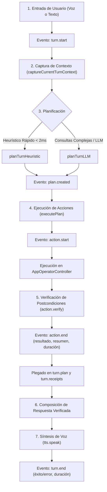

# Guía de Auditoría e Inspección de Ejecuciones del Asistente Zed

Esta guía proporciona el protocolo completo para que cualquier agente o desarrollador pueda inspeccionar, diagnosticar y depurar ejecuciones del Asistente Zed en Kite Code directamente desde la línea de comandos, sin depender de las herramientas de desarrollo gráficas (DevTools).

---

## 1. Ciclo de Vida de un Turno de Ejecución

Cada turno procesado por el Asistente Zed sigue una secuencia de eventos estructurada y determinista:



Los eventos se pliegan en el turno a medida que llegan: `plan.created` fija `turn.plan`, y `action.verify` / `action.end` crean o actualizan la entrada correspondiente en `turn.receipts`.

---

## 2. Los 3 Niveles de Almacenamiento de Trazas

Las ejecuciones del asistente se preservan en tres niveles complementarios. Para auditoría externa (CLI) la fuente de verdad es el **JSONL en disco**.

### A. Memoria en Tiempo Real (Ring Buffer de Trazas)
- **Módulo:** [`src/lib/operator/trace/trace.ts`](../../src/lib/operator/trace/trace.ts)
- **Capacidad:** los últimos **200** turnos (`MAX_TURNS = 200`); al desbordar se descarta el más antiguo.
- **Orden:** `getTurnTraces()` devuelve los turnos **del más reciente al más antiguo**, de modo que `turns[0]` es el último turno ejecutado.
- **Funciones Principales:**
  - `getTurnTraces()`: array de trazas acumuladas en memoria.
  - `getTurnTrace(turnId)`: traza de un turno específico por su identificador.
  - `subscribeTrace(callback)`: suscribe escuchadores para recibir eventos en vivo (`turn.start`, `plan.created`, `action.start`, `action.verify`, `action.end`, `tts.speak`, `turn.end`).
  - `exportTracesJson()`: serializa el buffer en memoria como JSON indentado (`JSON.stringify(turns, null, 2)`).
  - `parseTracesFromJsonl(contenido)`: reconstruye `OperatorTurnTrace[]` desde el JSONL de disco (ignora filas del `runLedger`, líneas vacías y JSON malformado).

### B. Caché Web (`localStorage`)
- **Clave:** `kite.operator.trace.v2` (la clave histórica `kite.operator.traces.v1` está obsoleta).
- **Propósito:** mantiene el historial disponible entre recargas de interfaz o cambios de pestaña lateral, con un máximo de 200 turnos.
- **Alcance:** exclusivo del WebView. Un proceso de Node no accede a `localStorage`, por lo que no sirve para auditar desde terminal.

### C. Persistencia en Disco (JSONL diario)
- **Ubicación en Windows:**
  - Producción: `%APPDATA%\Kite Code\operator-traces\<YYYY-MM-DD>.jsonl`
  - Desarrollo: `%APPDATA%\Kite Code Dev\operator-traces\<YYYY-MM-DD>.jsonl`
- **Escritura:** `operator_trace_append` agrega **una línea JSON por evento** al archivo del día (append, creando la carpeta si falta).
- **Ruta canónica:** `getOperatorTraceDiskPath()` consulta `operator_trace_path` en Rust y devuelve la carpeta `operator-traces`.
- **Contenido mixto:** el archivo contiene eventos de traza (`turnId` + `ev`) y filas del `runLedger` (`runId` + `type`). Las filas del ledger no son turnos y deben descartarse; `parseTracesFromJsonl` ya lo hace.
- **Atención:** el formato vigente **no** es LevelDB/Snappy. No busques trazas en `EBWebView\Default\Local Storage\leveldb`; esa ruta no contiene la telemetría del operador.

---

## 3. Comandos CLI para Diagnóstico Inmediato (Playbook para Agentes)

### A. Reconstruir el turno más reciente desde el JSONL de disco (recomendado)

```powershell
npx tsx -e "
import fs from 'node:fs';
import path from 'node:path';
import { parseTracesFromJsonl } from './src/lib/operator/trace/trace';

const roaming = process.env.APPDATA || '';
const candidates = ['Kite Code Dev', 'Kite Code'].map((app) => path.join(roaming, app, 'operator-traces'));
const dir = candidates.find((candidate) => fs.existsSync(candidate));

if (!dir) {
  console.log('No se encontró ninguna carpeta operator-traces en APPDATA.');
} else {
  const latest = fs.readdirSync(dir).filter((name) => name.endsWith('.jsonl')).sort().pop();
  if (!latest) {
    console.log('Todavía no hay archivos .jsonl en ' + dir);
  } else {
    const turns = parseTracesFromJsonl(fs.readFileSync(path.join(dir, latest), 'utf8'));
    console.log('Archivo: ' + latest + ' | turnos: ' + turns.length);
    if (turns.length > 0) {
      console.log(JSON.stringify(turns[0], null, 2));
    }
  }
}
"
```

- Ejecuta el comando desde la raíz del repositorio para que el import relativo resuelva.
- `tsx` se descarga en la caché de `npx` la primera vez.
- `turns[0]` es el turno más reciente (orden más reciente primero).
- Para un turno puntual: `turns.find((t) => t.turnId === '<id>')`.

### B. Exportar el buffer en memoria (solo dentro de la app)

`exportTracesJson()` devuelve `JSON.stringify(getTurnTraces(), null, 2)`. Es útil desde código que corre dentro de la aplicación (consola del WebView, una acción de diagnóstico o un test). Ejecutado en Node devuelve `[]`, porque el buffer arranca vacío y `localStorage` no existe sin `window`. Para auditar ejecuciones cerradas usa siempre el comando A.

### C. Probar cómo planifica el heurístico una orden específica (Simulación offline)
```powershell
npx tsx -e "
import { parseOperatorIntent, planTurnHeuristic } from './src/lib/operator/planner/heuristic';
const input = 'Quiero que cierres la terminal uno y dos';
console.log('Intent detectado:', parseOperatorIntent(input));
console.log('Plan generado:', planTurnHeuristic(input));
"
```

### D. Inspeccionar las terminales activas en memoria
```powershell
npx tsx -e "
import { getActiveAgentTerminals } from './src/lib/terminalRegistry';
console.log(getActiveAgentTerminals());
"
```

### E. Verificar qué carpeta de trazas está activa
```powershell
npx tsx -e "
import fs from 'node:fs';
import path from 'node:path';
const roaming = process.env.APPDATA || '';
for (const app of ['Kite Code Dev', 'Kite Code']) {
  const dir = path.join(roaming, app, 'operator-traces');
  console.log(app + ': ' + (fs.existsSync(dir) ? fs.readdirSync(dir).join(', ') : 'no existe'));
}
"
```

---

## 4. Estructura de Datos de una Traza (`OperatorTurnTrace`)

```typescript
export interface OperatorTurnTrace {
  turnId: string;              // Identificador único del turno (ej: 'turn-1730000000-abcd')
  startedAt: number;           // Marca de tiempo Unix (ms) del primer evento del turno
  input: string;               // Frase exacta dictada o escrita por el usuario
  source?: 'texto' | 'voz' | 'sugerencia' | 'shortcut';
  mode?: string;               // Modo de vista activo ('code', 'chat', 'files', etc.)
  workspaceId?: string;        // ID del workspace/proyecto activo
  workspaceName?: string;      // Nombre del proyecto activo
  workspacePath?: string;      // Ruta en disco del proyecto
  strategy?: 'heuristic' | 'llm' | 'heuristic-fallback';
  provider?: string;           // Proveedor LLM en consultas no heurísticas (ej: 'cloudflare', 'openai')
  model?: string;              // Modelo de lenguaje utilizado
  plan?: OperatorPlanTrace;    // Plegado del evento plan.created
  receipts?: ActionReceiptTraceEntry[]; // Plegado de action.verify / action.end, ordenado por actionIdx
  reply?: string;              // Respuesta final redactada o hablada
  overallSuccess?: boolean;    // Resultado global reportado por turn.end
  durationMs?: number;         // Latencia total de la ejecución en milisegundos
  error?: string;              // Error global en caso de fallo
  events: TraceEvent[];        // Secuencia completa de eventos (fuente primaria)
}
```

Los campos opcionales pueden faltar en trazas antiguas guardadas en `localStorage`; los consumidores deben tolerarlo.

### Plan plegado (`OperatorPlanTrace`):
```typescript
export interface OperatorPlanTrace {
  strategy: string;                          // Estrategia que produjo el plan
  actions: Array<Record<string, unknown>>;   // Acciones planificadas y validadas
  answer?: string;                           // Respuesta textual del planificador
  reply?: string;                            // Respuesta directa sin acciones
  fallbackReason?: string;                   // Motivo del fallback heurístico
}
```

### Detalle de Verificación por Acción (`ActionReceiptTraceEntry`):
```typescript
export interface ActionReceiptTraceEntry {
  actionIdx: number;           // Índice de la acción en el plan
  type: string;                // 'open_terminals' | 'close_terminals' | 'inject_prompt' | etc.
  ok: boolean;                 // true si action.end reportó status 'success'
  summaryEs?: string;          // Resumen hablado en español
  error?: string;              // Error reportado por action.end
  durationMs?: number;         // Duración reportada por action.end (ms)
  verification?: {
    ok: boolean;
    expected?: Record<string, unknown>;
    observed?: Record<string, unknown>;
    error?: string;
  };                           // Postcondición observada (action.verify)
}
```

`action.end` conserva el `verification` que haya adjuntado antes `action.verify`; si la acción no reportó verificación, el campo queda ausente.

---

## 5. Matriz de Diagnóstico de Fallos Frecuentes

| Síntoma observado | Dónde buscar en la traza | Causa raíz y solución |
|---|---|---|
| **La terminal no se cerró** | `receipts[i].verification.error` | El guardarraíl de seguridad descartó el verbo (comprobar formas en subjuntivo como `"cierres"`, `"ciérralas"` en `hasCloseVerb`), o el target numérico no correspondía al workspace actual. |
| **Se cerró solo 1 terminal de varias solicitadas** | `plan.actions` y `receipts` | El regex capturó únicamente el último número por tener ancla de fin de línea `$`. Debe usar `extractTerminalIndices` para capturar listas compuestas (`"1, 2"`). |
| **El asistente habla sobre terminales de otro proyecto** | `workspaceId`, `workspaceName` y `activeTerminals` | `captureCurrentTurnContext` no filtró por el proyecto actual, mezclando terminales de múltiples ventanas. Resuelto aislando las terminales por `workspaceId`. |
| **La voz local suena tras interrumpir al asistente** | `tts.speak` y `ttsNarrator` | `ttsNarrator.stop()` causó un error en el elemento de audio remoto, el cual activó erróneamente el fallback hacia `speakBrowser`. Resuelto mediante control de generación. |
| **La píldora del asistente se pone en rojo al instante** | `turn.error` | Clave de API faltante o inválida (por ejemplo, STT remoto o Cloudflare/ElevenLabs). Verificar configuración con `loadOperatorConfig()`. |
| **El CLI informa 0 turnos** | Comando ejecutado | Se invocó `getTurnTraces()` desde Node, donde el buffer está vacío por no existir `window`. Usa `parseTracesFromJsonl` sobre el `.jsonl` del día. |
| **El CLI no encuentra `.jsonl`** | `%APPDATA%\Kite Code Dev\operator-traces` | En desarrollo la carpeta es `Kite Code Dev`; en producción `Kite Code`. Compruébalo con el comando E. |
