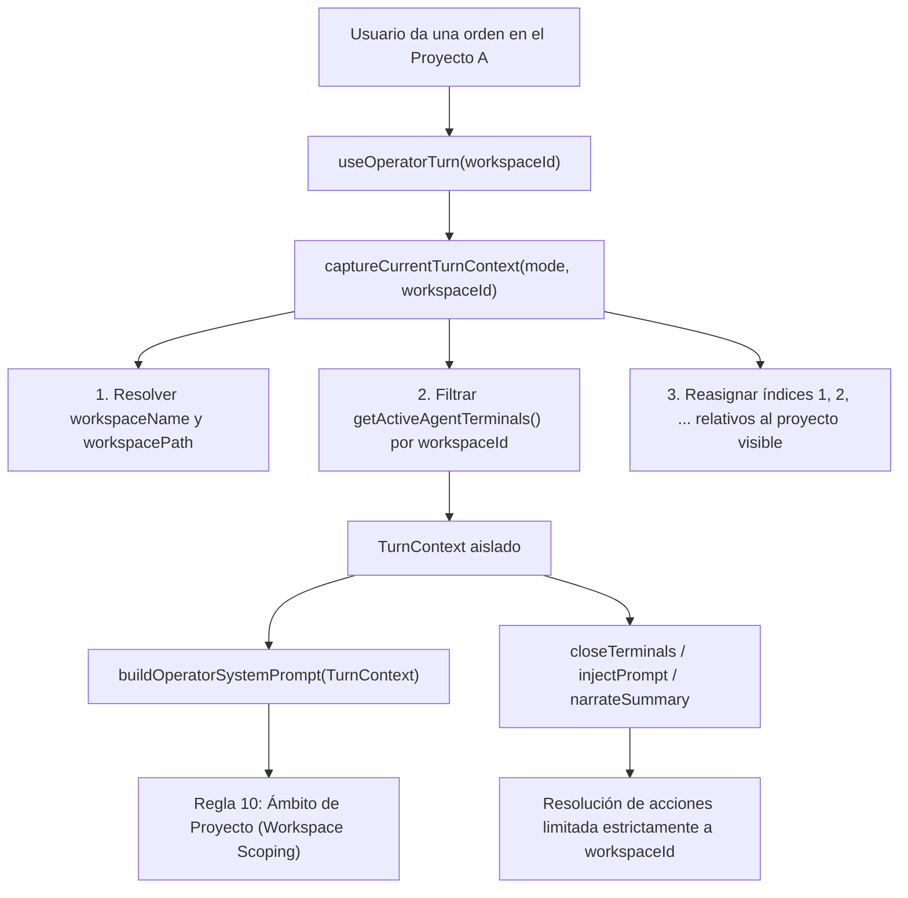

# Aislamiento y Contexto por Proyecto (Workspace Scoping)

Este documento detalla cómo el Asistente Zed (Kite Operator) detecta el proyecto o espacio de trabajo activo, cómo filtra las terminales para que coincidan con la vista del usuario y cómo se previene la contaminación cruzada o cierre erróneo de terminales en proyectos diferentes.

---

## 1. El Problema de la Contaminación Cruzada

### Síntoma
Cuando el usuario trabajaba en el Proyecto A (por ejemplo, con una terminal de PowerShell y un agente abierto), pero previamente tenía abiertas terminales de Antigravity en el Proyecto B:
- Al preguntar *"¿Qué agentes hay?"*, el asistente listaba las terminales del Proyecto B.
- Al pedir *"cierra la terminal 1"*, el asistente cerraba la terminal 1 del Proyecto B en lugar de la del proyecto actual.
- El modelo inventaba respuestas sobre estados y tareas de proyectos ajenos a la ventana activa.

### Causa Raíz
[`captureCurrentTurnContext`](file:///E:/kite/src/lib/operator/index.ts#L61-L105) invocaba `getActiveAgentTerminals()`, el cual devolvía **todas las terminales en memoria de todos los workspaces** sin filtrar por el `workspaceId` actual. Además, el prompt del sistema no informaba al modelo en qué proyecto estaba posicionado el usuario.

---

## 2. Arquitectura de Aislamiento por Proyecto



---

## 3. Implementación Paso a Paso

### A. Captura Contextual en `captureCurrentTurnContext`
En [`src/lib/operator/index.ts`](file:///E:/kite/src/lib/operator/index.ts#L61-L105):
1. **Resolución del Workspace Activo:**  
   Si no se pasa `workspaceId` explícito, se consulta `localStorage.getItem('kite.selectedWorkspaceId')`.
2. **Metadatos del Proyecto:**  
   Se leen los workspaces en caché para obtener el nombre visible (`workspaceName`) y la ruta en disco (`workspacePath`).
3. **Filtrado Estricto de Terminales:**  
   ```typescript
   const allTerminals = getActiveAgentTerminals();
   const filteredTerminals = resolvedWsId
     ? allTerminals.filter((t) => !t.workspaceId || t.workspaceId === resolvedWsId)
     : allTerminals;
   ```
4. **Re-indexación Relativa:**  
   Cada terminal en `activeTerminals` recibe `idx: i + 1` relativo al proyecto actual. De este modo, `"Terminal 1"` siempre coincide exactamente con la que el usuario ve en pantalla.

### B. Inyección de Contexto en el Prompt del Sistema
En [`src/lib/operator/planner/prompt.ts`](file:///E:/kite/src/lib/operator/planner/prompt.ts#L45-L65):
```text
10. AISLAMIENTO Y CONTEXTO DE PROYECTO (WORKSPACE SCOPING):
    - Estás operando EXCLUSIVAMENTE dentro del proyecto o workspace actual indicado en el CONTEXTO ACTUAL DEL SISTEMA.
    - La lista de terminales corresponde ÚNICAMENTE a las terminales abiertas en este proyecto actual.
    - Si el usuario te pregunta por terminales, agentes, proyectos o estado, responde basándote ÚNICAMENTE en este proyecto actual.
    - NUNCA menciones, cierres ni inventes terminales de otros proyectos o workspaces.

CONTEXTO ACTUAL DEL SISTEMA:
Proyecto actual: "MiProyecto" (Ruta: /ruta/al/proyecto) [ID: ws-1234]
Modo actual: code
Terminales abiertas en este proyecto:
Terminal 1: ID="term-abc", Motor=antigravity, Agente="Orion", ...
```

### C. Ejecutores Aislados por Workspace
- **[`closeTerminals`](file:///E:/kite/src/lib/operator/executor/actions/closeTerminals.ts#L10-L20):**  
  Pasa `context.workspaceId` a [`appOperatorController.closeTerminals`](file:///E:/kite/src/lib/operator/appOperatorController.ts#L268-L315), garantizando que índices numéricos como `1` o nombres de agente se resuelvan únicamente entre las terminales de ese workspace.
- **[`injectPrompt`](file:///E:/kite/src/lib/operator/executor/actions/injectPrompt.ts#L10-L20):**  
  Filtra las terminales activas antes de resolver `target: 'active'` o el índice solicitado.
- **[`narrateSummary`](file:///E:/kite/src/lib/operator/executor/actions/narrate.ts#L10-L20):**  
  Pasa `workspaceId` a [`sessionContextHub.getAllTerminalsSummary`](file:///E:/kite/src/lib/operator/sessionContextHub.ts#L95-L115), resumiendo únicamente las terminales del proyecto activo.
