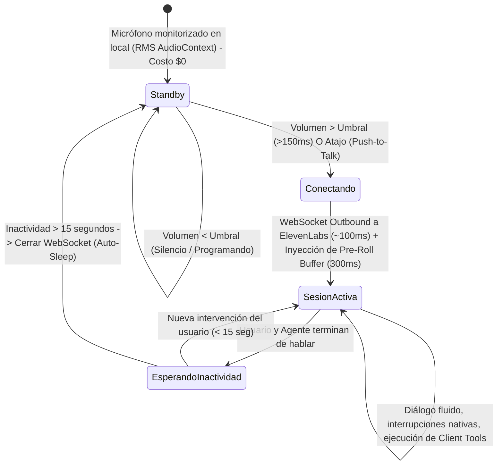

# Arquitectura y Evaluación de Integración: ElevenLabs para Asistente Zed (v2 Refinada)

Objetivo: Diseñar e implementar capacidades de voz hiperrealistas y conversación en tiempo real para el asistente Zed en Kite Code, incorporando los modelos de última generación de ElevenLabs (generación **Eleven v4** / **Eleven v4 Turbo**), evaluando en detalle la gestión de herramientas (Tools), la topología de red y un patrón de **conexión efímera por detección de volumen (Local VAD)** para eliminar sobrecostos de minutos en silencio.

Estado de rama: En evaluación. No cambiar de rama ni hacer commits en `main` o en ramas activas concurrentes sin aprobación explícita.

---

## 1. Actualización de Modelos y Catálogo de Última Generación (v4)

Verificación de la familia de modelos de síntesis y voz de ElevenLabs:

| Modelo | Identificador API (`model_id`) | Latencia | Características Principales | Costo API (x 1k caracteres) | Costo Créditos (Suscripción) |
| :--- | :--- | :--- | :--- | :--- | :--- |
| **Eleven v4 Turbo** | `eleven_v4_turbo` | **~100 ms** | **Última generación para agentes en tiempo real.** Expresividad emocional, ritmo humano, soporte para más de 90 idiomas. | **$0.04 USD** | 0.5 créditos / carácter (50% desc.) |
| **Eleven v4** | `eleven_v4` | ~200–300 ms | Modelo insignia para narración larga, audiolibros, doblaje y máxima fidelidad dramática. | $0.08 USD | 1 crédito / carácter |
| **Flash v2.5** | `eleven_flash_v2_5` | ~75 ms | Generación previa ultra-rápida enfocada en mínima latencia. | $0.04 USD | 0.5 créditos / carácter |
| **Multilingual v2**| `eleven_multilingual_v2` | ~250 ms | Modelo estándar previo de alta calidad multi-idioma. | $0.08 USD | 1 crédito / carácter |

> **Conclusión de Modelos:** Para asistentes conversacionales en tiempo real, el estándar actual más avanzado de ElevenLabs es **`eleven_v4_turbo`**, combinando ~100 ms de latencia con la expresividad y modulación contextual de la arquitectura v4.

---

## 2. Speech Engine vs. ElevenAgents: ¿Qué hace cada uno y quién maneja las Tools?

### A. ElevenLabs Speech Engine

* **¿Qué hace exactamente?**
  Es una infraestructura de tubería de audio en tiempo real. Proporciona:
  1. Captura de audio del usuario en el navegador/cliente.
  2. Speech-to-Text (STT) ultrarrápido con modelos de transcripción nativos de ElevenLabs.
  3. Voice Activity Detection (VAD) y detección de fin de turno.
  4. Interrupción (*barge-in*): emite señales de cancelación (`AbortSignal`) cuando el usuario empieza a hablar mientras el modelo está emitiendo audio.
  5. Text-to-Speech (TTS) en streaming hacia el cliente.
* **¿Quién gestiona el LLM?**
  **Tu propio servidor.** ElevenLabs no sabe qué modelo estás usando ni almacena prompts.
* **¿Quién maneja las Tools (Terminal, Archivos, Subagentes)?**
  **Tu propio servidor.** ElevenLabs es ciego a las herramientas. Si tu agente necesita ejecutar un comando de terminal en Kite o leer un archivo, tu propio código LLM invoca la función/tool, recibe el resultado y luego envía el texto generado a ElevenLabs para ser sintetizado.
* **Topología y Desafío Crítico:**
  **Inbound WebSocket.** ElevenLabs actúa como cliente y se conecta **hacia adentro** a tu servidor (`wsUrl`).
  *En una aplicación de escritorio (Kite en Tauri), las máquinas de los desarrolladores no tienen IPs públicas accesibles desde internet ni puertos abiertos. Para usar Speech Engine, se requeriría crear y mantener un servidor Cloud Relay intermedio en la nube que reciba a ElevenLabs y retransmita al desktop por un túnel.*

---

### B. ElevenAgents (Conversational AI / Voice Agents)

* **¿Qué hace exactamente?**
  Es una plataforma conversacional completa *Full-Stack* alojada en ElevenLabs:
  1. STT + VAD + Turn-Taking + TTS en su propia nube.
  2. Aloja el LLM conversacional (Claude 3.5 Haiku, GPT-4o mini, Gemini Flash) y el prompt de personalidad.
  3. Soporta memoria de sesión, base de conocimientos (RAG) y llamadas a funciones.
* **¿Quién maneja las Tools?**
  **Manejo Dual (Server Tools + Client Tools):**
  - **Server Tools:** Webhooks HTTP en la nube configurados en el dashboard de ElevenLabs.
  - **Client Tools (Crucial para Kite):** Funciones locales en TypeScript/JavaScript registradas en el cliente al iniciar la sesión:
    ```typescript
    const conversation = await Conversation.startSession({
      agentId: "...",
      clientTools: {
        runTerminalCommand: async ({ command }) => {
          const output = await executeInKiteTerminal(command);
          return output; // Se envía de vuelta a ElevenLabs por el WebSocket
        },
        readWorkspaceFile: async ({ path }) => {
          return await readProjectFile(path);
        }
      }
    });
    ```
    Cuando el agente en la nube decide ejecutar una tool, emite la solicitud por el WebSocket, Kite la ejecuta localmente en la máquina del usuario y devuelve el resultado a ElevenLabs para que el agente continúe hablando.
* **Topología:**
  **Outbound WebSocket.** El cliente de escritorio Kite se conecta directamente a `wss://api.elevenlabs.io`. **Funciona de inmediato en Tauri sin servidores públicos ni túneles.**

---

## 3. Estrategia de Conexión Efímera (Local VAD & Auto-Sleep)

Para evitar el costo abusivo de mantener un canal de audio abierto durante horas de silencio ($0.08/min × 480 min = $38.40 USD al día):



### Mecanismo de Ahorro:
1. **Modo Escucha Pasiva en Local (Costo $0.00):**
   Aprovecha el `AudioAnalyser` ya implementado en `src/lib/operator/voice/zedVoice.ts`. El micrófono analiza el volumen RMS en la máquina local.
2. **Buffer de Pre-Roll (300 ms):**
   Un buffer circular en memoria almacena los últimos 300 ms de audio para no cortar la primera sílaba mientras se negocia el handshake del WebSocket.
3. **Cierre Automático por Inactividad (Auto-Sleep a los 15s):**
   Si no hay intercambio verbal durante 15 segundos, se llama a `conversation.endSession()`.
4. **Impacto Económico Real:**
   En una jornada de 8 horas, los intercambios verbales reales suman en promedio entre 10 y 20 minutos.
   - Costo con conexión permanente (8 horas): **$38.40 USD / día** ($768 USD / mes).
   - Costo con VAD Efímero (15 min reales): **$1.20 USD / día** ($24 USD / mes).
   - **Ahorro neto: 96.8% en costos de ElevenAgents.**

---

## 4. Comparativa de Beneficio Neto entre Enfoques

| Dimensión | Enfoque 1: Streaming TTS Híbrido (`eleven_v4_turbo`) | Enfoque 2: ElevenAgents Efímero con Client Tools | Enfoque 3: Speech Engine (Inbound WS) |
| :--- | :--- | :--- | :--- |
| **¿Quién piensa (LLM)?** | El cerebro nativo de Kite (Grok, OpenCode Go, Gemini Flash, Local) | ElevenLabs Cloud (GPT-4o mini, Claude Haiku, Gemini) | El cerebro de tu servidor |
| **¿Cómo ejecuta Tools?** | Directo en Kite (cero intermediación de red) | Vía callbacks de *Client Tools* en el WebSocket | Directo en tu servidor |
| **Latencia de voz** | ~500–700 ms (STT local/Grok + LLM + TTS streaming) | **~400–600 ms (extrema fluidez)** | ~600–900 ms (+ latencia del relay) |
| **Interrupción de voz** | Local: `AudioAnalyser` detecta habla y corta audio inmediatamente | Nativa: ElevenLabs silencia y emite evento de interrupción | Nativa en ElevenLabs |
| **Infraestructura requerida** | Ninguna. Conexión directa a API REST/WS de ElevenLabs | Ninguna. Conexión directa con `@elevenlabs/client` | **Alta.** Requiere servidor Relay público en la nube |
| **Costo típico diario (Kite)** | **~$0.16 USD / día** (~$3.20 USD / mes) | **~$1.20 USD / día** (~$24.00 USD / mes) | **~$38.40 USD / día** (o $1.20 si es efímero + costo de servidor relay) |

---

## 5. Recomendación Técnica y Hoja de Ruta

1. **Paso Inmediato de Mayor Retorno de Inversión (ROI):**
   Implementar el driver de **`eleven_v4_turbo`** en `ttsNarrator.ts`.
   - Reemplaza la voz robótica actual de `window.speechSynthesis` por la voz humana más avanzada de ElevenLabs.
   - Costo mensual irrisorio (~$3.50 USD / mes).
   - No cambia la arquitectura interna de Zed ni sus tools ni sus subagentes.

2. **Paso Opcional Avanzado ("Modo Llamada Manos Libres con Zed"):**
   Implementar **ElevenAgents con Client Tools** y el patrón de **Auto-Sleep / Conexión Efímera**:
   - Activable desde un botón en la UI o con atajo de voz.
   - Conecta con `@elevenlabs/client`.
   - Conecta las herramientas de Kite (`runTerminal`, `readFile`, `explainCode`) como `clientTools`.
   - Corta el WebSocket automáticamente tras 15 segundos de inactividad para garantizar que nunca genere costos accidentales.
