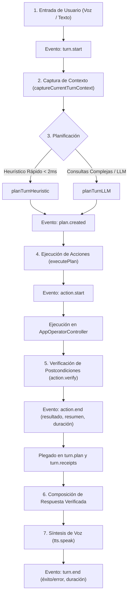

# Guía de Auditoría e Inspección de Ejecuciones del Asistente Zed

Esta guía documenta la arquitectura de observabilidad, almacenamiento y diagnóstico paso a paso para que cualquier agente o desarrollador pueda inspeccionar, depurar y auditar con precisión cada turno de ejecución del **Asistente Zed (Kite Operator)** sin depender de las DevTools del navegador.

---

## 1. Ciclo de Vida de un Turno de Ejecución

Cada interacción con el Asistente Zed (por voz o texto) sigue un flujo determinista y emite eventos estructurados a lo largo de su ciclo de vida:



Cada evento se pliega de forma acumulativa en el turno: `plan.created` fija `turn.plan`, y `action.verify` / `action.end` crean o actualizan la entrada correspondiente en `turn.receipts`.

---

## 2. Dónde y Cómo se Almacenan las Ejecuciones

Las trazas de cada ejecución se registran en tres niveles complementarios. La fuente de verdad para auditoría externa es el **JSONL en disco**; la memoria y `localStorage` son cachés de la aplicación.

### A. Memoria en Tiempo Real (Ring Buffer de Trazas)
- **Módulo:** `src/lib/operator/trace/trace.ts`
- **Capacidad:** Los últimos **200** turnos (`MAX_TURNS = 200`). Al superar el límite se descarta el turno más antiguo.
- **Orden:** `getTurnTraces()` devuelve los turnos **del más reciente al más antiguo** (`turnOrder.unshift`), por lo que `turns[0]` es siempre el último turno.
- **Funciones de Acceso:**
  - `getTurnTraces()`: array de trazas acumuladas en la sesión (más reciente primero).
  - `getTurnTrace(turnId)`: traza detallada de un turno específico por su ID.
  - `subscribeTrace(callback)`: suscribe un observador para recibir eventos en vivo.
  - `exportTracesJson()`: serializa el buffer en memoria como JSON con indentación de dos espacios.

### B. Caché Web (`localStorage`)
- **Clave:** `kite.operator.trace.v2` (la clave histórica `kite.operator.traces.v1` ya no se utiliza).
- **Contenido:** serialización JSON de los últimos turnos (hasta 200), preservados entre recargas de vista o cambios de pestaña.
- **Limitación:** solo existe dentro del WebView de la aplicación. Un script de Node **no** la ve, por eso la inspección por CLI se hace sobre el JSONL en disco.

### C. Almacenamiento en Disco (JSONL por día)
- **Ubicación en Windows:**
  - Producción: `%APPDATA%\Kite Code\operator-traces\<YYYY-MM-DD>.jsonl`
  - Desarrollo (`cfg!(debug_assertions)`): `%APPDATA%\Kite Code Dev\operator-traces\<YYYY-MM-DD>.jsonl`
- **Comando que la resuelve:** `getOperatorTraceDiskPath()` en `src/lib/operator/trace/trace.ts`, que invoca `operator_trace_path` (Rust) y devuelve la carpeta `operator-traces`.
- **Escritura:** cada evento se agrega como **una línea JSON** mediante `operator_trace_append`, que abre el archivo del día en modo append y crea la carpeta si no existe.
- **Contenido mixto:** el mismo archivo recibe eventos de traza (con `turnId` y `ev`) y filas del `runLedger` (con `runId` y `type`). Por eso la reconstrucción debe usar `parseTracesFromJsonl`, que ignora las filas del ledger, las líneas vacías y el JSON malformado.
- **Importante:** la auditoría ya **no** se hace sobre LevelDB/Snappy del perfil WebView2. No inspecciones `EBWebView\Default\Local Storage\leveldb`: esos archivos no contienen las trazas del operador.

---

## 3. Comandos para Inspeccionar Turnos desde CLI (Playbook para Agentes)

### A. Reconstruir los turnos del archivo JSONL más reciente (recomendado)

`parseTracesFromJsonl` reconstruye `OperatorTurnTrace[]` a partir del contenido del `.jsonl`, con el mismo plegado de `plan` y `receipts` que usa la aplicación. Funciona en Node sin `window`.

```powershell
npx tsx -e "
import fs from 'node:fs';
import path from 'node:path';
import { parseTracesFromJsonl } from './src/lib/operator/trace/trace';

const roaming = process.env.APPDATA || '';
const candidates = ['Kite Code Dev', 'Kite Code'].map((app) => path.join(roaming, app, 'operator-traces'));
const dir = candidates.find((candidate) => fs.existsSync(candidate));

if (!dir) {
  console.log('No se encontró ninguna carpeta operator-traces en APPDATA.');
} else {
  const latest = fs.readdirSync(dir).filter((name) => name.endsWith('.jsonl')).sort().pop();
  if (!latest) {
    console.log('Todavía no hay archivos .jsonl en ' + dir);
  } else {
    const turns = parseTracesFromJsonl(fs.readFileSync(path.join(dir, latest), 'utf8'));
    console.log('Archivo: ' + latest + ' | turnos: ' + turns.length);
    if (turns.length > 0) {
      console.log(JSON.stringify(turns[0], null, 2));
    }
  }
}
"
```

- La primera vez, `npx` descarga `tsx` en la caché local. Ejecuta el comando desde la raíz del repositorio para que el import relativo resuelva.
- El resultado respeta el orden más reciente primero: `turns[0]` es el último turno ejecutado.
- Si solo interesa un turno concreto, filtra por `turns.find((t) => t.turnId === '<id>')`.

### B. Exportar el buffer en memoria (solo dentro de la aplicación)

`exportTracesJson()` serializa `getTurnTraces()` con `JSON.stringify(..., null, 2)`. Está pensado para usarse desde código que corre dentro de la app (por ejemplo una acción de diagnóstico, la consola del WebView o un test). **Desde un script de Node devuelve `[]`**, porque el buffer en memoria arranca vacío y `localStorage` no existe sin `window`; para auditoría por CLI usa siempre el comando A.

### C. Inspección del Planificador Heurístico para una Frase Concreta
Para probar cómo interpreta el sistema una orden de usuario sin ejecutarla:
```powershell
npx tsx -e "
import { parseOperatorIntent, planTurnHeuristic } from './src/lib/operator/planner/heuristic';
const input = 'Quiero que cierres la terminal uno y dos';
console.log('Intent:', parseOperatorIntent(input));
console.log('Plan:', planTurnHeuristic(input));
"
```

### D. Verificar la carpeta de trazas activa
```powershell
npx tsx -e "
import fs from 'node:fs';
import path from 'node:path';
const roaming = process.env.APPDATA || '';
for (const app of ['Kite Code Dev', 'Kite Code']) {
  const dir = path.join(roaming, app, 'operator-traces');
  console.log(app + ': ' + (fs.existsSync(dir) ? fs.readdirSync(dir).join(', ') : 'no existe'));
}
"
```

---

## 4. Estructura de Datos de una Traza (`OperatorTurnTrace`)

Cada turno registrado contiene la siguiente información (los campos opcionales pueden faltar en trazas antiguas):

```typescript
export interface OperatorTurnTrace {
  turnId: string;              // Identificador único (ej: 'turn-1730000000-abcd')
  startedAt: number;           // Marca de tiempo Unix (ms) del primer evento del turno
  input: string;               // Frase original dictada o escrita por el usuario
  source?: 'texto' | 'voz' | 'sugerencia' | 'shortcut';
  mode?: string;               // Modo de vista activo ('code', 'chat', 'files', etc.)
  workspaceId?: string;        // ID del proyecto activo
  workspaceName?: string;      // Nombre visible del proyecto activo
  workspacePath?: string;      // Ruta en disco del proyecto
  strategy?: 'heuristic' | 'llm' | 'heuristic-fallback';
  provider?: string;           // Proveedor LLM si no fue heurístico (ej: 'cloudflare', 'openai')
  model?: string;              // Modelo LLM utilizado
  plan?: OperatorPlanTrace;    // Plegado del evento plan.created
  receipts?: ActionReceiptTraceEntry[]; // Plegado de action.verify / action.end, ordenado por actionIdx
  reply?: string;              // Respuesta final redactada o hablada
  overallSuccess?: boolean;    // Resultado global reportado por turn.end
  durationMs?: number;         // Latencia total de la ejecución en milisegundos
  error?: string;              // Mensaje de error si el turno falló
  events: TraceEvent[];        // Secuencia completa de eventos (fuente primaria de la traza)
}
```

### Plan plegado (`OperatorPlanTrace`):
```typescript
export interface OperatorPlanTrace {
  strategy: string;                          // Estrategia que produjo el plan
  actions: Array<Record<string, unknown>>;   // Acciones planificadas tal como se validaron
  answer?: string;                           // Respuesta textual del planificador
  reply?: string;                            // Respuesta directa sin acciones
  fallbackReason?: string;                   // Motivo del fallback heurístico
}
```

### Detalle de Verificación en Cada Acción (`ActionReceiptTraceEntry`):
```typescript
export interface ActionReceiptTraceEntry {
  actionIdx: number;           // Índice de la acción dentro del plan
  type: string;                // 'open_terminals' | 'close_terminals' | 'inject_prompt' | etc.
  ok: boolean;                 // true si la acción terminó en éxito (action.end.status === 'success')
  summaryEs?: string;          // Resumen en español para confirmación por voz
  error?: string;              // Error reportado por action.end
  durationMs?: number;         // Duración reportada por action.end (ms)
  verification?: {
    ok: boolean;
    expected?: Record<string, unknown>;
    observed?: Record<string, unknown>;
    error?: string;
  };                           // Postcondición verificada (evento action.verify)
}
```

`verification` solo aparece cuando el ejecutor reportó una verificación de postcondición para esa acción; `turn.receipts` conserva el `verification` previo aunque después llegue `action.end`.

---

## 5. Diagnóstico de Problemas Frecuentes

| Síntoma detectado | Dónde mirar en la traza | Causa común |
|---|---|---|
| **La terminal no se cerró** | `receipts[i].verification.error` | El guardarraíl `hasCloseVerb` descartó el verbo (revisar formas en subjuntivo), o el target numérico no correspondía al workspace actual. |
| **Se cerró sólo 1 terminal de varias pedidas** | `plan.actions` y `receipts` | El heurístico capturó sólo el último número en vez de una lista compuesta (`target: '1, 2'`). |
| **El asistente habla sobre otro proyecto** | `workspaceId`, `workspaceName` y `activeTerminals` | Las terminales no fueron filtradas por el workspace actual, provocando contaminación cruzada. |
| **La voz local suena tras interrumpir** | `tts.speak` y `ttsNarrator` | La síntesis remota fue interrumpida por el usuario (`stop()`), provocando que el error de cancelación activara erróneamente el fallback a la voz nativa del navegador. Resuelto mediante control de generación. |
| **La orden no respondió y dio error rojo en la píldora** | `turn.error` o `plan.fallbackReason` | Clave de API faltante o expirada en el proveedor configurado, o fallback heurístico forzado. |
| **El CLI devuelve 0 turnos** | Comando ejecutado | Se usó `getTurnTraces()` en Node (buffer vacío, sin `window`). Usa `parseTracesFromJsonl` sobre el `.jsonl` del día. |
| **El CLI no encuentra archivos `.jsonl`** | `%APPDATA%\Kite Code Dev\operator-traces` | En desarrollo la carpeta es `Kite Code Dev`; en producción `Kite Code`. Verifica con el comando D. |
