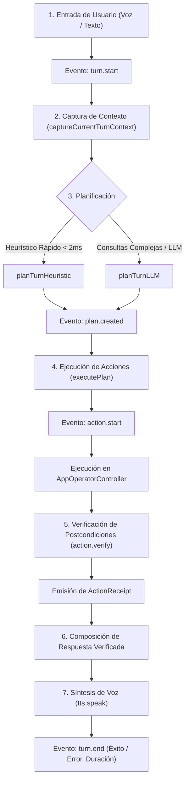

# Guía de Auditoría e Inspección de Ejecuciones del Asistente Zed

Esta guía documenta la arquitectura de observabilidad, almacenamiento y diagnóstico paso a paso para que cualquier agente o desarrollador pueda inspeccionar, depurar y auditar con precisión cada turno de ejecución del **Asistente Zed (Kite Operator)** sin depender de las DevTools del navegador.

---

## 1. Ciclo de Vida de un Turno de Ejecución

Cada interacción con el Asistente Zed (por voz o texto) sigue un flujo determinista y emite eventos estructurados a lo largo de su ciclo de vida:



---

## 2. Dónde y Cómo se Almacenan las Ejecuciones

Las trazas de cada ejecución se registran en tres niveles complementarios:

### A. Memoria en Tiempo Real (Ring Buffer de Trazas)
- **Módulo:** `src/lib/operator/trace/trace.ts`
- **Capacidad:** Almacena los últimos 50 turnos (`MAX_TRACES = 50`).
- **Funciones de Acceso:**
  - `getTurnTraces()`: Devuelve el array completo de trazas acumuladas en la sesión.
  - `getTurnTrace(turnId)`: Devuelve la traza detallada de un turno específico por su ID.
  - `subscribeTrace(callback)`: Suscribe un observador para recibir eventos en vivo.
  - `exportTracesJson()`: Exporta todas las trazas formateadas en JSON.

### B. Almacenamiento Web (SessionStorage / LocalStorage)
- **Clave de Sesión:** `kite.operator.traces.v1`
- **Contenido:** Serialización JSON de los últimos turnos ejecutados, preservados entre recargas de vista o cambios de pestaña.

### C. Almacenamiento en Disco (WebView2 LevelDB)
- **Ubicación:**  
  `%LOCALAPPDATA%\Kite Code\EBWebView\Default\Local Storage\leveldb`  
  (o la carpeta de perfil WebView2 correspondiente en Windows).
- **Estructura física:** Archivos `.ldb` y `.log` comprimidos con Snappy en formato LevelDB.
- **Ventaja para Agentes:** Permite auditar ejecuciones históricas cerradas incluso si la aplicación se reinició.

---

## 3. Comandos para Inspeccionar Turnos desde CLI (Playbook para Agentes)

Cualquier agente puede ejecutar inspecciones directas con comandos sin necesidad de abrir la interfaz gráfica:

### Inspección Rápida de Últimos Turnos vía TSX
```powershell
npx tsx -e "
import { getTurnTraces } from './src/lib/operator/trace/trace';
const traces = getTurnTraces();
console.log('Total turnos en memoria:', traces.length);
if (traces.length > 0) {
  const last = traces[traces.length - 1];
  console.log('Último turno:', JSON.stringify(last, null, 2));
}
"
```

### Inspección del Planificador Heurístico para una Frase Concreta
Para probar cómo interpreta el sistema una orden de usuario sin ejecutarla:
```powershell
npx tsx -e "
import { parseOperatorIntent, planTurnHeuristic } from './src/lib/operator/planner/heuristic';
const input = 'Quiero que cierres la terminal uno y dos';
console.log('Intent:', parseOperatorIntent(input));
console.log('Plan:', planTurnHeuristic(input));
"
```

### Inspección de la Base de Datos LevelDB en Disco (Script Autónomo)
Para extraer turnos directamente de los archivos `.ldb` de WebView2 en Windows:
```javascript
import fs from 'node:fs';
import path from 'node:path';
import snappy from 'snappy';

const levelDbDir = path.join(process.env.LOCALAPPDATA, 'Kite Code', 'EBWebView', 'Default', 'Local Storage', 'leveldb');
const files = fs.readdirSync(levelDbDir).filter(f => f.endsWith('.ldb') || f.endsWith('.log'));

for (const file of files) {
  const buf = fs.readFileSync(path.join(levelDbDir, file));
  // Buscar bloques que contengan la clave 'kite.operator.traces' o 'turn-'
  // e imprimir los objetos JSON recuperados.
}
```

---

## 4. Estructura de Datos de una Traza (`OperatorTurnTrace`)

Cada turno registrado contiene la siguiente información exhaustiva:

```typescript
export interface OperatorTurnTrace {
  turnId: string;              // Identificador único (ej: 'turn-1730000000-abcd')
  timestamp: number;           // Marca de tiempo Unix en milisegundos
  input: string;               // Frase original dictada o escrita por el usuario
  source: 'texto' | 'voz' | 'sugerencia' | 'shortcut';
  mode?: string;               // Modo de vista activo ('code', 'chat', 'files', etc.)
  workspaceId?: string;        // ID del proyecto activo
  workspaceName?: string;      // Nombre visible del proyecto activo
  workspacePath?: string;      // Ruta en disco del proyecto
  strategy: 'heuristic' | 'llm' | 'heuristic-fallback';
  providerId?: string;         // Proveedor LLM si no fue heurístico (ej: 'cloudflare', 'openai')
  model?: string;              // Modelo LLM utilizado
  plan?: OperatorPlan;         // Plan de acciones generado
  receipts: ActionReceipt[];   // Resultados y verificaciones de cada acción ejecutada
  reply?: string;              // Respuesta final redactada o hablada
  overallSuccess: boolean;     // true si todas las acciones y verificaciones fueron exitosas
  durationMs: number;          // Latencia total de la ejecución en milisegundos
  error?: string;              // Mensaje de error si el turno falló
}
```

### Detalle de Verificación en Cada Acción (`ActionReceipt`):
```typescript
export interface ActionReceipt {
  actionIdx: number;
  type: string;                // 'open_terminals' | 'close_terminals' | 'inject_prompt' | etc.
  ok: boolean;                 // true si la postcondición se cumplió
  summaryEs: string;           // Resumen en español para confirmación por voz
  data?: unknown;              // IDs de sesión afectados, conteo, etc.
  verification?: {
    expected: Record<string, unknown>;
    observed: Record<string, unknown>;
    ok: boolean;
    error?: string;
  };
  error?: string;
  durationMs?: number;
}
```

---

## 5. Diagnóstico de Problemas Frecuentes

| Síntoma detectado | Dónde mirar en la traza | Causa común |
|---|---|---|
| **La terminal no se cerró** | `receipts[i].verification.error` | El guardarraíl `hasCloseVerb` descartó el verbo (revisar formas en subjuntivo), o el target numérico no correspondía al workspace actual. |
| **Se cerró sólo 1 terminal de varias pedidas** | `plan.actions` y `receipts` | El heurístico capturó sólo el último número en vez de una lista compuesta (`target: '1, 2'`). |
| **El asistente habla sobre otro proyecto** | `context.workspaceId` y `activeTerminals` | Las terminales no fueron filtradas por el workspace actual, provocando contaminación cruzada. |
| **La voz local suena tras interrumpir** | `tts.speak` y `ttsNarrator` | ElevenLabs fue interrumpido por el usuario (`stop()`), provocando que el error de cancelación activara erróneamente el fallback a la voz nativa del navegador. Resuelto mediante control de generación (`myGen === generation`). |
| **La orden no respondió y dio error rojo en la píldora** | `turn.error` o `fallbackReason` | Clave de API faltante o expirada en el proveedor configurado (Grok / Cloudflare / ElevenLabs). |
